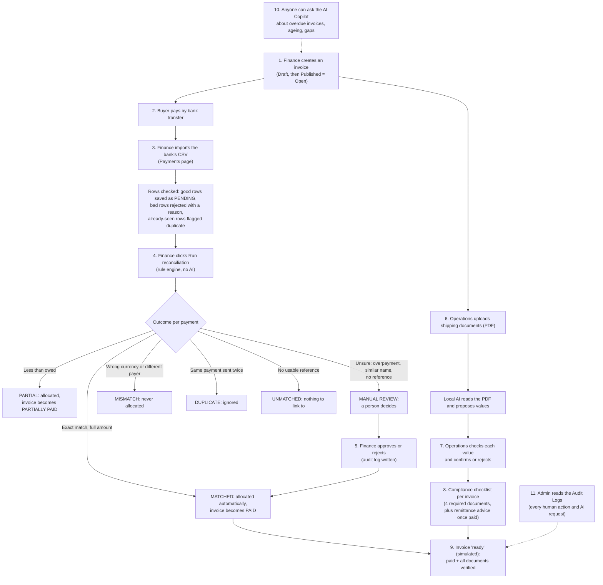

# TradeFlow AI: how the application works

A plain-language guide: who the users are, how to log in, what the business problem is, and exactly what to click, in what order, and what happens behind the scenes.

---

## 1. Logins and addresses

### App accounts (all passwords: `Demo@12345`)

| Role | Email | What this person does in real life |
|---|---|---|
| **Admin** | `admin@example.com` | Manager. Sees everything, and is the only one who can read the Audit Logs. |
| **Finance** | `finance@example.com` (Farhan Finance) | Accounts team. Owns invoices, bank payments and reconciliation. |
| **Operations** | `operations@example.com` (Olivia Operations) | Shipping and paperwork team. Owns documents and compliance. |

The login page has one-click buttons for these three, so you don't need to type anything.

### What each role can open

| Menu item | Admin | Finance | Operations |
|---|:-:|:-:|:-:|
| Overview | financial dashboard | financial dashboard | own landing page with shortcuts, no payment figures |
| Invoices | create/edit | create/edit | view only |
| Payments | yes | yes | no |
| Reconciliation | yes | yes | no |
| Documents | yes | no | yes |
| Compliance | yes | no | yes |
| AI Copilot | yes | yes | yes (some questions refused) |
| Audit Logs | yes | no | no |
| Settings | yes | yes | yes |

The rules are enforced by the backend, not only hidden in the menu. Typing a forbidden address just redirects you away, and calling the API directly returns "forbidden".

### Addresses

| What | Address |
|---|---|
| The app (open this) | http://localhost:5173 |
| Backend API | http://localhost:8000 |
| Interactive API docs | http://localhost:8000/docs |
| PostgreSQL (for a DB tool) | `localhost:5433`, database `tradeflow`, user `tradeflow`, password `tradeflow_dev_password` |
| Ollama (local AI) | http://localhost:11434, model `qwen2.5:3b` |

These DB credentials are for the local Docker demo only.

---

## 2. The business problem

TradeFlow AI imagines an **Indian export company** that sells goods (textiles, spices, engineering parts) to **overseas buyers** and gets paid by bank transfer, often in USD, EUR, GBP or AED.

Money and paperwork go wrong in predictable ways:

- The buyer pays the **wrong amount**, or only part of it.
- The buyer pays in the **wrong currency**.
- The bank sends the **same payment twice**.
- The transfer has **no invoice reference**, or a different company name than the buyer.
- A **shipping document disagrees** with the invoice.
- Nobody can easily see which invoices are overdue or which paperwork is missing.

TradeFlow AI lets the Finance team and the Operations team see and fix these problems quickly. The golden rule: **software decides the money, the AI only reads and explains.** The AI can read a PDF and reword an answer, but it can never create a payment, match an invoice or change a number.

All names, companies and amounts are fictional.

---

## 3. The whole flow in one picture



---

## 4. Step by step, by screen

### Step 1: Invoices (Finance)

**Menu: Invoices.** A table of all export invoices with search, filters (status, currency, buyer, dates) and sorting.

- **New invoice** opens a form: exporter, buyer, dates, currency, amount, terms. It saves as **Draft**.
- Open a draft and click **Publish** to make it **Open** (issued to the buyer).
- The detail page shows the amount, the amount **Received**, the **Outstanding** balance, the payment history, and a **lifecycle timeline** with five steps: invoiced, payment received, paid in full, documents verified, and filing readiness (simulated).
- You can cancel an invoice only if no payment has been applied to it. Once payments exist, its number, currency, exporter and buyer are locked.

**The status is never typed in.** It is worked out automatically:

```
PAID  >  OVERDUE  >  PARTIALLY PAID  >  OPEN        (Draft and Cancelled are set by a person)
```

An invoice is Overdue when the due date has passed and money is still owed. Paid wins over everything.

### Step 2 and 3: Payments (Finance)

**Menu: Payments, then "Import payments".** This stands in for downloading the bank statement.

Upload a CSV with these columns: `transaction_reference, payment_reference, sender_name, currency, amount, transaction_date, bank_reference`. Try `sample_data/payments.csv`. Each row is checked:

| Row problem | What happens |
|---|---|
| Looks fine | Saved with status **Pending** |
| Transaction reference already imported | Counted as **Duplicate**, not saved again |
| Bad currency, unreadable amount, bad date, missing sender | **Rejected**, with the reason; you can download the error report as a CSV |

The sample file gives you **4 accepted, 2 duplicates, 4 rejected** on a freshly seeded database, so you see every case.

Importing does **not** match anything yet. Payments just wait as Pending.

### Step 4: Reconciliation (Finance)

**Menu: Reconciliation, then "Run reconciliation".** Every Pending payment goes through the rule engine, in this order:

1. **Duplicate?** Same reference, sender, currency, amount and date as an earlier payment: `DUPLICATE`.
2. **Reference:** does the payment reference equal an invoice number? If not, `UNMATCHED` (or a suggestion if name and amount resemble one).
3. **Currency:** different from the invoice? `MISMATCH`. Currencies are never converted.
4. **Buyer name** (fuzzy match): too different (below 60%)? `MISMATCH`. Somewhere in between? a person must confirm.
5. **Amount** against what is still owed: exact is `MATCHED`, less is `PARTIAL`, more is `MANUAL REVIEW` (the engine never over-allocates).

Each result shows an **explanation in plain words**, the candidate invoices, and a confidence number (labelled as an estimate).

### Step 5: Reviewing the uncertain ones (Finance)

Click a result to open the review panel. For **Manual review** items you can:

- **Approve allocation:** pick the invoice (only same-currency invoices with a balance are offered), optionally enter a smaller amount, add a note.
- **Reject candidate:** say it is not that invoice.

Both are recorded in the audit log with who did it and when. The database itself refuses an over-allocation or a wrong-currency allocation, even if the app had a bug.

In the same panel, **Explain in plain words** asks the AI for a plain-English explanation of why. The explanation is wording only, and the decision stays with the rules.

### Step 6 and 7: Documents (Operations)

**Menu: Documents.** Upload a PDF (type, and optionally the invoice it belongs to). Try the files in `sample_data/documents/`.

1. **Run AI extraction.** The local model reads the PDF text (takes about a minute on a normal PC). Nothing leaves your machine.
2. You see a form: invoice number, exporter, buyer, country, currency, amount, dates.
   - Each value is tagged **Found in document** (the text really contains it) or **Not in document: verify**.
   - The AI's own confidence is shown as "AI estimate", never as proof.
3. **Edit anything wrong, then "Confirm these values"** (or **Reject document**).
4. If the document is linked to an invoice, the confirmed values are **compared with the invoice**. `INV-1018_commercial_invoice_amount_differs.pdf` shows a document total of 11,500 against an invoice of 11,000, and the document's explain action puts that in words.

Confirming a document creates no invoice and no payment. It only marks the paperwork as verified.

### Step 8 and 9: Compliance (Operations)

**Menu: Compliance.** One row per issued invoice with a progress count. Open one to see the **checklist**:

- Always required: **Commercial Invoice, Packing List, Shipping Bill, Bill of Lading / Airway Bill**.
- **Remittance Advice** becomes required once a payment has arrived.
- An item is verified when a confirmed document of that type exists, **or** a person records a manual review ("paper original checked") with remarks. Manual reviews are append-only: they are never edited or deleted.
- When the invoice is **paid, every required item is verified, and nothing disagrees**, it reads **Ready (simulated)**. A note beside it says this is a demo check, not legal or regulatory approval.

### Step 10: AI Copilot (everyone)

**Menu: AI Copilot.** Type a question or click a suggestion. It supports eight kinds: overdue invoices, pending-payment ageing, unreconciled payments, discrepancies, top outstanding buyers, missing documents, explain an invoice, explain a transaction.

How an answer is made:

1. Plain rules work out what you asked (the AI is only a fallback to pick one of the known questions).
2. Your **role is checked first**, before any data is fetched.
3. A fixed query reads the numbers from the database and builds a correct draft answer.
4. The AI may **reword** that draft. If the reworded text adds or loses a number or reference, it is thrown away.
5. If the AI is offline, slow or rejected, you get the plain draft instead, labelled **Standard answer**. AI-reworded answers are labelled **AI-generated wording**.

It cannot answer anything outside those eight questions, and it never writes SQL.

### Step 11: Audit Logs (Admin only)

**Menu: Audit Logs.** Two tabs:

- **Activity:** every manual action (approvals, rejections, status changes, document confirmations, compliance reviews) with who, when, and the **before and after values**. Filter by action, user and dates.
- **AI requests:** every AI call with the model name, outcome and duration, plus a short summary. Document contents are never stored here.

### Overview dashboard (Finance and Admin)

**Menu: Overview.** Totals shown **per currency, never added together**: invoice value, payments received, pending amount; counts of invoices, fully reconciled, partially paid, unmatched payments, overdue; a monthly invoiced-versus-received chart in one currency at a time; payments by status; invoices by currency; recent transactions; outstanding invoices. Every number comes from live database totals, not typed-in values.

---

## 5. What the demo data contains

Seeded by `python -m app.db.seed` (which also resets everything).

### 15 invoices

| Invoice | Buyer | Amount | Situation |
|---|---|---|---|
| INV-1010 | Northwind Imports LLC | USD 12,500 | **Paid** (a duplicate payment was also sent) |
| INV-1011 | Alpenrose Handels GmbH | EUR 8,400 | **Paid** |
| INV-1012 | Thames Gate Wholesale Ltd | GBP 6,750 | **Paid** (duplicate payment too) |
| INV-1013 | Al Noor General Trading LLC | AED 45,000 | **Overdue**, nothing received |
| INV-1014 | Lumière Distribution SAS | EUR 15,200 | **Overdue**, EUR 5,000 received |
| INV-1015 | Caledonia Retail Group Ltd | GBP 9,300 | **Overdue**, a no-reference payment awaits review |
| INV-1016 | Gulf Crest Foods FZE | AED 62,500 | **Overdue**, AED 30,000 received |
| INV-1017 | Northwind Imports LLC | USD 22,000 | Open, paid in the wrong currency (EUR) |
| INV-1018 | Alpenrose Handels GmbH | EUR 11,000 | Open, paid in the wrong currency (USD) |
| INV-1019 | Harbor & Pine Trading Co | USD 7,800 | **Paid** |
| INV-1020 | Al Noor General Trading LLC | AED 28,000 | **Overdue**, nothing received |
| INV-1021 | Thames Gate Wholesale Ltd | GBP 5,200 | Open, overpaid (GBP 6,000), awaiting review |
| INV-1022 | Lumière Distribution SAS | EUR 9,900 | Open, paid by a *different company* with the same reference |
| INV-1023 | Northwind Imports LLC | USD 3,400 | **Draft** |
| INV-1024 | Harbor & Pine Trading Co | USD 10,000 | **Partially paid** (6,000 + 3,500 received, 500 left) |

### 20 payments and what the engine concluded

| Result | Payments | Why |
|---|---|---|
| Matched (4) | TXN-1001, 1002, 1003, 1020 | Right reference, currency, name and full amount |
| Partial (4) | TXN-1004, 1005, 1006, 1007 | Right invoice, but less than owed |
| Mismatch (3) | TXN-1008, 1009, 1017 | Wrong currency (two) or different payer (one) |
| Duplicate (2) | TXN-1010, 1011 | Bank sent the same payment again |
| Manual review (2) | TXN-1018, 1019 | No reference but similar name, and an overpayment |
| Unmatched (5) | TXN-1012 to 1016 | Reference is a PO number, an unknown remittance, or missing |

### Sample files to try (folder `sample_data/`)

- `payments.csv`: the import demo (4 accepted, 2 duplicates, 4 rejected). After importing, run reconciliation and watch INV-1013, INV-1014, INV-1020 and INV-1024 become **Paid**.
- `payment_packs/`: four more bank files for different demo stories (next section).
- `documents/INV-1024_commercial_invoice.pdf`, `INV-1021_...`, `INV-1022_...`: clean invoices; the AI should read every field correctly.
- `documents/INV-1018_commercial_invoice_amount_differs.pdf`: the document total does not agree with the invoice.
- `invoices.csv`: reference listing of the seeded invoices (there is no invoice import screen).

### Payment packs (`sample_data/payment_packs/`)

More bank files for a Finance demo. Import one on the **Payments** page, then click **Run reconciliation**. They are regenerated with recent dates every time you reseed, and every outcome below was checked against the real app.

| File | Story | What you will see |
|---|---|---|
| `01_clean_month_end.csv` | The perfect month: ten buyers each pay exactly what they owe. | 10 accepted, **10 Matched**. Every issued invoice becomes **Paid** (only the draft, INV-1023, stays unpaid). The Overview shows nothing overdue afterwards. |
| `02_messy_bank_day.csv` | A realistic bad day at the bank. | 16 accepted: **4 Matched, 3 Partial, 3 Manual review, 3 Mismatch, 2 Unmatched, 1 Duplicate** (details below). |
| `03_validation_errors.csv` | A badly produced file. | 16 rows: **3 accepted, 12 rejected, 1 duplicate**. Each rejected row fails a different rule, and the error report CSV lists the reason for each. |
| `04_high_volume.csv` | A busy quarter. | 60 unrelated receipts across 90 days, all **Unmatched**. Fills the trend chart, the currency chart and the Unmatched count. |

**Use only one of packs 01 and 02 per database**, because they pay the same invoices. To start over, reseed: `cd backend`, then `.venv/Scripts/python -m app.db.seed`. Packs 03 and 04 can be imported at any time.

What pack 02 contains, row by row:

| Row | What the bank did | Result |
|---|---|---|
| TXN-4001, 4002, 4003 | Paid part of INV-1013, INV-1017, INV-1018 | Partial |
| TXN-4004 | Paid EUR 10,500 on a EUR 9,900 invoice | Manual review (overpayment is never allocated automatically) |
| TXN-4005 | Right reference, but a company that is not the buyer | Mismatch |
| TXN-4006 | Paid in USD for an AED invoice | Mismatch (never converted) |
| TXN-4007 | No reference; name and amount look right | Manual review (a suggestion only) |
| TXN-4008 | Wrote the reference in lower case (`inv-1014`) | Matched (case is ignored) |
| TXN-4009 | Spelled the buyer "Limited" instead of "Ltd" | Matched (the names are close enough) |
| TXN-4010 and TXN-4011 | The same payment sent twice | Matched, then Duplicate |
| TXN-4012 | Paid INV-1010, which is already settled | Manual review |
| TXN-4013 | Paid INV-1023, which is still a draft | Mismatch |
| TXN-4014, 4015 | Reference matches no invoice (`INV-9876`, a PO number) | Unmatched |
| TXN-4016 | Paid the last USD 500 of INV-1024 | Matched |

Good demo order: pack 02 (shows the engine handling every case), then reseed and pack 01 (the happy path), then pack 03 (validation and the error report).

**About invoices.** There is no invoice CSV import screen, so `sample_data/invoices.csv` is a reference listing of the 15 seeded invoices. New invoices are created on the **Invoices** page.

---

## 6. A guided 10-minute walkthrough

Reset first if you have been experimenting: `cd backend`, then `.venv/Scripts/python -m app.db.seed`.

1. **Log in as Finance.** Look at **Overview**: four currencies, never merged.
2. **Invoices.** Open INV-1024: partially paid, 500 outstanding, timeline in progress.
3. **Payments, Import.** Upload `sample_data/payments.csv`. See 4 accepted, 2 duplicates, 4 rejected. Download the error report.
4. **Reconciliation, Run.** Four new payments are matched. INV-1024 becomes Paid.
5. **Reconciliation.** Open TXN-1019 (GBP 6,000 on a GBP 5,200 invoice). Read the explanation, approve it, add a note.
6. **AI Copilot.** Ask "Which invoices are overdue?" Note the label. Optionally stop Ollama and ask again: the answer is the same, labelled Standard.
7. **Log out. Log in as Operations.** Open **Documents** and upload `INV-1024_commercial_invoice.pdf`. Run extraction, review the fields, confirm.
8. **Compliance.** Open INV-1010. Record a review for each item. Watch it turn **Ready (simulated)**.
9. **Documents.** Upload the amount-differs PDF, link it to INV-1018, run extraction and read the comparison with the invoice.
10. **Log in as Admin. Audit Logs.** See every action you just took, with before and after values, and every AI request with its duration.

---

## 7. Under the hood, briefly

```
Browser (React, port 5173)
   |  /api/v1 + login token (JWT)
FastAPI backend (port 8000)
   routes (thin, check role)  ->  services (the rules)  ->  repositories (SQL)
                                      |                        |
                          reconciliation engine          PostgreSQL (port 5433)
                          (pure rules, no AI)        constraints + triggers guard the money
                                      |
                          Ollama (port 11434, local AI: reads PDFs, rewords answers only)
```

For more depth see [architecture.md](architecture.md), [database-schema.md](database-schema.md) and [api-documentation.md](api-documentation.md).

---

## 8. If something looks wrong

| Symptom | Fix |
|---|---|
| Login page loads but sign-in fails | Backend is not running: `cd backend`, then `.venv/Scripts/python -m uvicorn app.main:app --reload --port 8000` |
| Pages show errors or empty data | Database is down: `docker compose up -d db` |
| Documents say the AI is offline | Start Ollama (`ollama serve`) and make sure `qwen2.5:3b` is pulled. The rest of the app works without it. |
| Demo data is messy after experimenting | `cd backend`, then `.venv/Scripts/python -m app.db.seed` (wipes and rebuilds everything) |
| Frontend not loading | `cd frontend`, then `npm run dev` |
