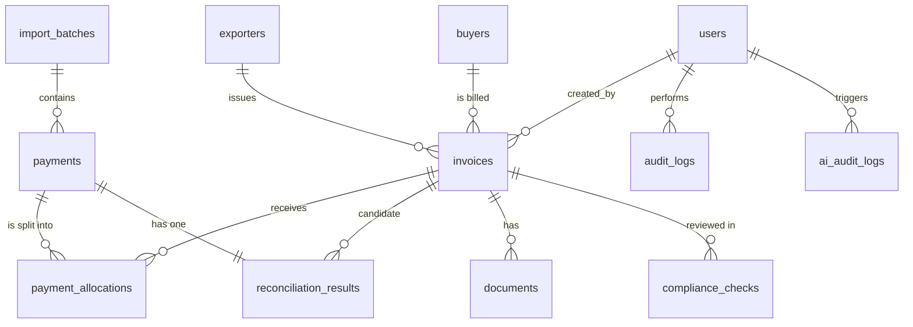

# Database schema

PostgreSQL 16. Migrations are Alembic (`backend/migrations/versions`); triggers are installed from `app/db/triggers.py`. Enums are stored as `VARCHAR` with a `CHECK` constraint (not native PG enums). Every table has a UUID primary key and a UTC `created_at`.

## Tables

### Parties and users
| Table | Key columns |
|---|---|
| `exporters` | `company_name`, `country`, `email` |
| `buyers` | `buyer_name` (indexed), `country`, `email` |
| `users` | `email` (unique), `password_hash` (Argon2), `role` (ADMIN, FINANCE, OPERATIONS), `is_active` |

### Money
| Table | Key columns and rules |
|---|---|
| `invoices` | `invoice_number` (unique), `exporter_id`, `buyer_id`, `invoice_date`, `due_date`, `currency` (3 letters), `total_amount NUMERIC(18,2)`, `status`. CHECK: total > 0, due date after invoice date. `status` accepts DRAFT, OPEN, PARTIALLY_PAID, PAID, OVERDUE, CANCELLED, but only DRAFT and CANCELLED are set by people; the rest are derived from allocations and due date when read. |
| `import_batches` | `file_name`, `total_rows`, `accepted_rows`, `rejected_rows`, `duplicate_rows`, `errors` (JSONB), `imported_by` |
| `payments` | `transaction_reference` (unique), `payment_reference`, `sender_name`, `currency`, `amount NUMERIC(18,2)`, `transaction_date`, `bank_reference`, `status`. CHECK: amount > 0 |
| `payment_allocations` | `payment_id`, `invoice_id`, `allocated_amount NUMERIC(18,2)`, `currency`, `allocation_type` (AUTO, MANUAL), `allocated_by`. **Append-only**; triggers enforce the limits below. |
| `reconciliation_results` | one row per payment (unique on `payment_id`): `status`, `match_method`, `confidence`, `invoice_id`, amounts at decision time, `explanation`, `candidates` (JSONB), `review_decision`, `review_note`, `reviewed_by`, `reviewed_at` |

Trigger rules on `payment_allocations`: allocation is at most the payment's unallocated amount; at most the invoice's outstanding amount; currency equals both the payment's and the invoice's; no UPDATE or DELETE.

### Documents and compliance
| Table | Key columns |
|---|---|
| `documents` | `invoice_id` (optional), `file_name`, `file_path`, `document_type`, `extraction_status`, `verification_status`, `extracted_data` (JSONB, model output with grounding), `confirmed_data` (JSONB, what a person approved), `uploaded_by` |
| `compliance_checks` | append-only manual reviews: `invoice_id`, `document_type`, `status`, `remarks`, `reviewed_by` |

### Audit
| Table | Key columns |
|---|---|
| `audit_logs` | `user_id`, `action`, `entity_type`, `entity_id`, `old_values`, `new_values` (JSONB). Indexed on action, entity type, entity id and user. |
| `ai_audit_logs` | `user_id`, `operation_type`, `model_name`, `request_summary`, `response_summary`, `status`, `duration_ms`, `details` (JSONB). Short summaries only; never document text. |

## Beyond the original BRD tables

`reconciliation_results` and `import_batches` were added because the API needs them (decision history, import history and error reports). `documents.confirmed_data` keeps what the AI proposed separate from what a person confirmed.

## Indexes worth knowing

`invoices(status, buyer_id, invoice_number)`, `payments(transaction_reference, payment_reference, transaction_date, status)`, `payment_allocations(payment_id, invoice_id)`, `reconciliation_results(payment_id, invoice_id)`, and the four audit-log filters.
